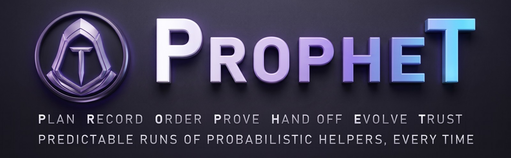
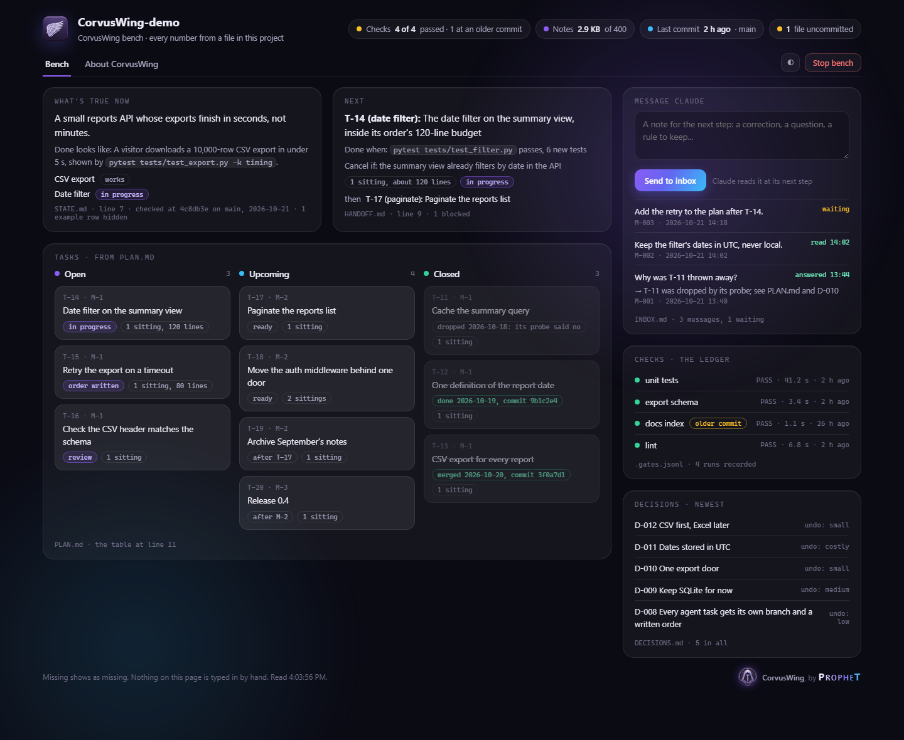

# CorvusWing

**A deterministic process around a probabilistic model.** Created by Ron Brazil.

Everyone says their AI workflow is deterministic. Almost none of them are. The model guesses, and
that part never changes. What *can* be deterministic is everything around the model: the order work
is done in, the record it leaves, and the checks it has to pass. CorvusWing makes that part
deterministic, and that part is the one you can check.

CorvusWing is a small kit of skills and templates for Claude Code, and for every coding agent that
reads `AGENTS.md` (Codex, Cursor, Copilot, Gemini CLI, Aider and others). It gives your agents rails:
a written order before every task, a git safety net under every change, notes that carry the work
from one session to the next and across the automatic summary, checks that are proven able to fail,
and one page where you can see all of it and leave the agent a note.

If your agents have been rewriting code you never asked them to touch, spending money on work you had
to throw away, and leaving you no further along than months ago: that is a common pattern, and it is
not a verdict on you. It mostly comes from a few missing brakes. Each one is small. This kit installs
them.

## The PROPHET method

Seven steps, one for each letter. Each is done by a skill in this kit.

| Step | What it means | Done by |
|---|---|---|
| **P**lan | Start at "done" and work backwards to today; test the riskiest assumption first, with the cheapest probe that could prove it false. | `start-here` |
| **R**ecord | What is true, what is next and why things are the way they are live in short files every session reads, never in anyone's memory. | `session-close` |
| **O**rder | Every task gets a written order first: its files, a size budget, a done-criterion, a cancel condition, and its own git branch. | `scope-guard` |
| **P**rove | "It works" means a check anyone can rerun, and every check is proven able to fail. | `gates`, `solution-integrity` |
| **H**and off | A session ends, or is summarized to free up room, without losing what cannot be worked out again; the next one tests the note before trusting it. | `compaction`, `context-guard` |
| **E**volve | A mistake becomes a rule the same day, with its reason; a "cannot" is checked before it closes a door. | `holding-the-goal`, `working-discipline` |
| **T**rust | Trust is earned by checking: every number on the bench comes from a file, and anything missing shows as missing. | `bench` |

None of this makes the model deterministic. It makes the process deterministic, and the process is
the part you can check.

## The problems it solves

1. **Agents rewrite things nobody asked for.** `scope-guard` makes every task name its files and a
   size budget before it starts, makes the agent stop and ask before going outside them, and gives
   you a ten-second way to reject an oversized change without reading it.
2. **Work is hard to recover.** Every task starts with a commit and its own branch (a branch is a
   separate line of work in git that you can merge or throw away). Every unattended run starts with
   a tag (a named bookmark on a commit). Undoing a bad run is one command.
3. **Sessions lose state.** `session-close` writes down what is true, what is next and what was
   decided. The next session checks those notes against the repository before trusting them.
4. **The automatic summary takes unwritten work.** When a conversation fills up, it is summarized,
   and whatever was not written down is now a guess. `context-guard` watches how full the session is
   and, well before that point, has `compaction` write a note that carries the work across: sorted
   by what each fact costs if it comes back wrong, with orders already carried out kept apart from
   rules still in force, and ending in a list of facts each with the command that checks it.
5. **No route to done.** `start-here` writes a plan with you (PLAN.md): it starts at "done", works
   backwards to today, and puts the riskiest assumption first. Every task after that has a place on
   the route, so an agent is never just "working on stuff".
6. **Building before thinking.** `solution-integrity`, `holding-the-goal` and `working-discipline`
   are question lists to run before and after a change: is the premise measured, what would cancel
   this task, is this "cannot" real.
7. **"It works" cannot be checked.** `gates` builds one command that runs every check, a ledger that
   remembers each run against the files it checked, a deliberate fault per check that proves it can
   fail, and a progress window for long runs.
8. **Notes that grow until nobody reads them.** Finished work moves, unchanged, into an `archive/`
   folder, leaving one pointer line behind, so the notes every session reads stay small: under
   400 KB together, with a warning at 300 KB. Nothing is trimmed or deleted; it is moved and pointed to.
9. **You cannot see the project at a glance, or leave the agent a note.** `bench` starts one local
   page: what is true now, what is next, the tasks open, upcoming and closed, the checks, the newest
   decisions, and a Message Claude box whose notes the agent reads at its next step. A desktop icon
   opens it with one click; its Stop button, or simply closing the page, shuts it down.

## How to ask: the opener

Start every request with this, then say what you want:

> Prior to any decisions or code design I want you to run the whole skill holding-the-goal,
> and then invoke the appropriate portions of the next two skills that allow you to
> successfully complete the task (name the parts you use of these two skills):
> solution-integrity, working-discipline.

Then your request, for example: *"Then: add a CSV export to the reports page."*

The same sentence is written into AGENTS.md by `start-here`, so the agent follows it even on the day
you forget to paste it. Pasting it anyway costs nothing and makes it the first thing the agent reads.
In the reply, the agent should name the parts it used; if it does not, ask.

## What is in the box

| Path | What it is |
|---|---|
| `skills/start-here/` | First-run interview. Keeps your original work safe, asks about your project, then sets up the notes, the house rules (AGENTS.md, which most agent tools read, and CLAUDE.md, which imports it for Claude Code), the plan and git. |
| `skills/scope-guard/` | The anti-rewrite rules: commit, branch, scope, size budget, review, roll back. |
| `skills/session-close/` | Ends a session: commits, brings the notes current, archives what finished, keeps the notes small, then runs `compaction`. |
| `skills/compaction/` | Writes PICKUP.md, the note that carries a session across a summary or to the next day, and makes the next session check it first. |
| `skills/context-guard/` | Watches how full the session is; at about 85% it starts nothing new and has the note written before the automatic summary can come. |
| `skills/solution-integrity/` | Twelve questions before, during and after a change. |
| `skills/holding-the-goal/` | Questions to run before saying "cannot", and before saying "we should fix this". |
| `skills/working-discipline/` | Habits for arriving in a codebase, reading, measuring, building and reporting. |
| `skills/gates/` | Builds the check suite: one command, a ledger, a proof that each check can fail, and a progress window. One part per session, after start-here. |
| `skills/bench/` | The bench: `serve.mjs` (a small server, Node 18 or newer, no packages), `bench.html` (the page), `shortcut.mjs` (puts its icon on the desktop), and the bench's images. |
| `templates/` | Short starting versions of the loop documents: PLAN, STATE, HANDOFF, DECISIONS, PICKUP, FILEMAP, ORDER, REPORT, LESSONS, AGENTS and CLAUDE, plus the archive's index (ARCHIVE-README). |
| `LICENSE` | The MIT License. |
| `NOTICE.md` | What the license covers, and the names and marks it does not. |

## Install

A skill is a folder with a SKILL.md file in it. Claude Code looks for skills in two places.

**The easy way:** download or clone this repository, open Claude Code in its folder, and paste:

> Install this kit for every project: copy each folder under `skills/` into my personal skills
> folder (`~/.claude/skills/`, on Windows `%USERPROFILE%\.claude\skills\`); copy `templates/` into
> `~/.claude/skills/start-here/templates/`; and copy `README.md`, `LICENSE` and `NOTICE.md` into
> `~/.claude/skills/bench/about/`. If a skill with the same name is already there, stop and ask me
> before replacing it. Then list what you copied.

**By hand**, the same steps:

1. Pick a place:
   - For every project: your personal skills folder, `~/.claude/skills/`
     (on Windows, `%USERPROFILE%\.claude\skills\`).
   - For one project only: `.claude/skills/` inside that project.
2. Copy each folder under `skills/` into it, so you end up with `.../skills/start-here/SKILL.md`,
   `.../skills/scope-guard/SKILL.md`, and so on.
3. Copy the `templates/` folder into the start-here folder, so it sits at
   `.../skills/start-here/templates/`. The start-here and session-close skills look for the
   templates there.
4. Copy `README.md`, `LICENSE` and `NOTICE.md` into `.../skills/bench/about/`, so the bench's About
   tab can show them.
5. Start a new Claude Code session so it picks up the skills. In recent versions, typing `/` lists
   them (for example `/start-here`).

If you already have skills with the same names, rename the folder and the `name:` line in its
SKILL.md together.

## What it does to your project, and what it never does

- **First, your original is kept safe.** Before anything changes, `start-here` makes a sealed snapshot
  of your project (a zip, with a list of every file's fingerprint, checked file by file and then made
  read-only) and a clean working copy beside it, checked the same way. Your original folder is never
  touched again, by the kit or by any agent after it. All work happens in the working copy. A note in
  it, `SAFE-COPY.md`, says where everything is and how to get anything back.
- **In the working copy, it adds** the notes files (STATE, HANDOFF, PLAN, DECISIONS, LESSONS, PICKUP,
  FILEMAP, ORDER, REPORT), the house rules (AGENTS.md and CLAUDE.md), an `archive/` folder with its
  index, a `.gitignore`, and git itself if the project was not in git yet. The bench adds INBOX.md
  when you send it your first message.
- **It reads** your code, your README and any notes or plans you already keep, and offers to copy their
  open items into the plan, naming where each came from. With your yes, the loose notes files then move
  into `archive/original-notes/`, so the working copy's root is clean.
- **It never moves your code.** Moving source files breaks imports and builds. If you want the code
  reorganized, it becomes a task in the plan, with an order, a branch and a review, like any other,
  and the snapshot means nothing can be lost doing it.
- **The bench stays on your machine, and only while you use it.** It listens on 127.0.0.1 only,
  refuses requests from other web pages, loads nothing from the internet, writes one file (INBOX.md),
  and stops by itself once you close its page. Its desktop icon starts it with no console window.

## The daily loop, in six steps

1. **Arrive.** Paste PICKUP.md into a new session. The agent checks the notes against the repository
   first: `git status`, `git log -3`, and one test whose number the notes state. Then it reads any
   waiting messages in INBOX.md.
2. **Pick one task.** Take the top item from HANDOFF.md, which comes from the plan in PLAN.md. One task
   per session is plenty.
3. **Think before building.** Run `solution-integrity` on it. Write the probe that could cancel the
   task (a quick check that would show the task is not needed) and run it first.
4. **Write the order, then branch.** Fill in ORDER.md: files in scope, size budget, done-criterion,
   stop conditions. Commit, then `git switch -c task/<id>-<short-name>`.
5. **Let the agent work, then review.** It stops when done, or when it needs to go outside scope. You
   check `git diff --stat` against the budget, read the diff, run the tests and read REPORT.md. Then
   merge it, or throw the branch away.
6. **Close.** Run `session-close`: commit, mark the task done in PLAN.md, update STATE.md and
   HANDOFF.md, add to DECISIONS.md, move what finished into `archive/` with a pointer, check the notes'
   size, and write PICKUP.md with `compaction`.

## Start here

Open Claude Code in your project folder and run the `start-here` skill (type `/start-here`, or say
"run the start-here skill"). It asks about ten short questions, one or two at a time, sets everything
up, writes the plan with you, and names one small first task. It does not build anything in that
session. That is on purpose: the first real work goes better on top of the rails.

Then, if the project has no single command that runs every check, run the `gates` skill next
(`/gates`). It builds the suite one part per session; the first part alone gives every later task a
"done" anyone can check. And whenever you want to watch the project on one page, ask for the bench
(`/bench`); ask it for a desktop icon too, and from then on one click opens it.

## A few honest notes

- **The model still varies.** The process around it is deterministic; the model is not, and will not
  be. The rails make its variation visible and recoverable, not absent.
- These skills are instructions, not locks. An agent can still ignore them. The locks are git (you
  can always go back) and your look at the diff (nothing merges unread).
- Small tasks feel slow. They are faster. A 50-line change you can review in two minutes beats a
  2,000-line change you have to throw away.
- Change anything here to fit how you work. The templates are starting points, not law.

## The name

Corvus is the raven, the messenger of the old stories: it flies out, sees, and comes back with word. The
wing is what carries the work across, from one session to the next and through the automatic summary,
so nothing that was learned has to be learned twice.

## License

The skills, templates, bench and text are released under the MIT License (`LICENSE`): use them,
change them and share them, in any project, including commercial ones. The names CorvusWing and PROPHET,
the CorvusWing wing icon, and the PROPHET emblem, wordmark and banner are not covered by that license;
`NOTICE.md` says what that means.

What you build with the kit is yours: your code, and the notes the kit writes about your project.

---

CorvusWing. Created by Ron Brazil, signed PROPHET.
